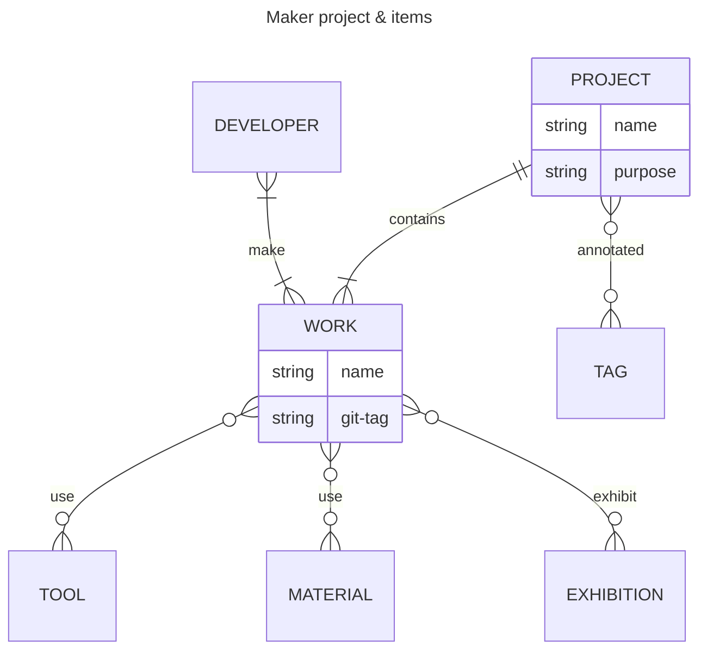

# BotaLab Profile Page (Template of Maker Page Generator)

[](https://github.com/botamochi6277/botalab/actions/workflows/pages.yml)

This is template to deploy a maker profile page

## Widgets

- **Projects**: project cards with pin (spotlight) toggle, saved in the browser's localStorage. Each card links to a project detail page (`/projects/<id>`).
- **Project detail**: ProtoPedia link, a horizontal timeline of the project's works, and work cards (newest first) with ruby, tools/materials icons, awards and create date.
- **Exhibition Timeline**: created from `src/assets/exhibitions.json`, with year chips for jumping.
- **Stats** and **Network**: charts and a relation graph built from the ProtoPedia data.

## Install

```console
git clone https://github.com/botamochi6277/botalab.git your_page
cd your_page
npm install
```

### dev run

```console
npm run dev
```

### build

```console
npm run build   # type-check, bundle to dist/, copy index.html to 404.html
```

### Update ProtoPedia data

```console
mkdir -p public/prototypes
node scripts/fetch_prototype_v2.js <userName> <api_key>
```

Options: `-o` output JSON, `--img_dir`, `--projects_output`.
This writes `src/assets/prototypes_v2.json`, downloads images into `public/prototypes/` (gitignored), and merges the fetched data into `src/assets/projects.yml` (matched by `protopedia_id`; new prototypes are appended as `pp-<id>`).

## Data structure

### items

- projects
- works
- developers
- materials
- tools
- tags
- exhibitions

### data files (`src/assets/`)

| file                 | content                                                                                                                                                                     |
| -------------------- | --------------------------------------------------------------------------------------------------------------------------------------------------------------------------- |
| `projects.yml`       | projects (1 project has n works): `protopedia_id`, `developingStatus`, `mainImage`, `description`, `developers`, `topics`, `pinned`, ...                                    |
| `works.yml`          | works: `project_id`, `name`, `ruby`, `materials`, `tools`, `awards`, `createDate`, `mainImage` (URL, or a file name in `public/works/`)                                     |
| `exhibitions.json`   | exhibitions: `date`, `name`, `link`, `location`, `icon` (file name in `public/exhibitions/` or a MUI icon name), `prototype_ids` (ProtoPedia ids) and `work_ids` (work ids) |
| `prototypes_v2.json` | raw ProtoPedia data (generated; used by Stats / Network)                                                                                                                    |
| `profile.json`       | team/profile info                                                                                                                                                           |

Tool and material icons are SVG files in `public/tools/` and `public/materials/`, mapped by name in `src/ToolIcon.tsx`.

ProtoPedia service has no project, tool, and exhibitions. Data registered to ProtoPedia is insufficient to describe maker activities and project progress.


